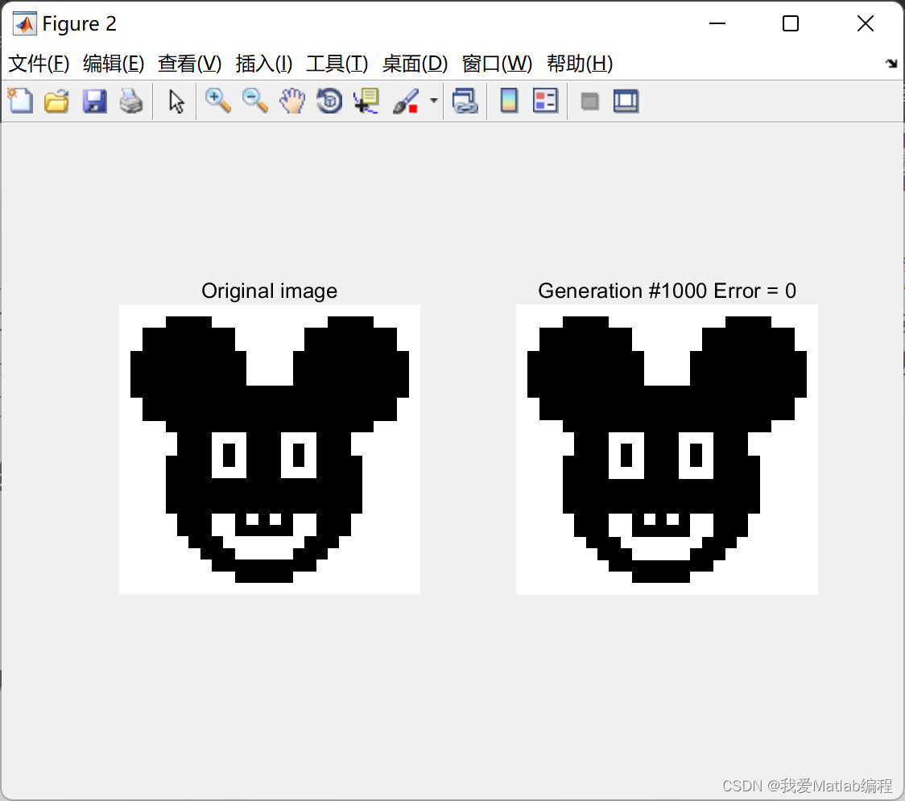
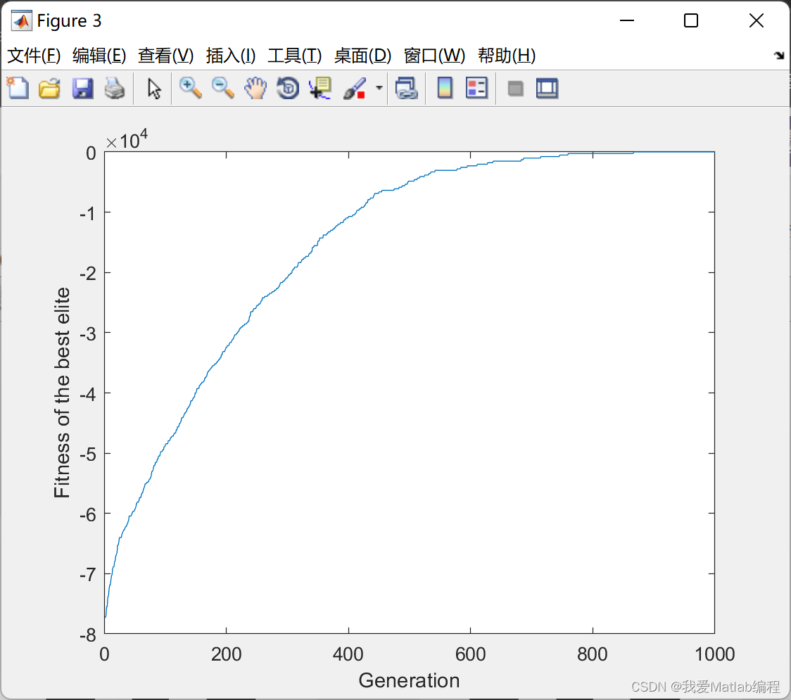

# Binary Image Reconstruction Based on Genetic Algorithm (Matlab Code Implementation)

1. Overview
The image resolution is an important technical indicator for evaluating the imaging system of an image. Image resolution is divided into spatial resolution, grayscale resolution, and spectral resolution, etc. In practical applications, it is often a difficult task to achieve the required resolution through existing conditions due to various factors. In our country, even for the real-time transmission type reconnaissance satellites planned for launch, the ground resolution of images is not only far below the development level of the United States and Russia but also fails to meet the technological level of France, Japan, and Israel. It can be seen that how to use low-resolution imaging technology to obtain high-resolution images has become one of the essential key technologies for developing our country's aerospace, military, and other fields. As early as the 1960s, the concept of super-resolution was proposed, and the initial methods included frequency harmonic extrapolation method, energy continuous reduction method, long ellipsoidal function method, linear mean square extrapolation method, and superimposition sinusoidal template method, etc. To this day, it remains one of the hot topics in the field of image processing that needs further research.
2. Running Results
Edit:
Part of the code:
clear
clc
close all
fileName = 'IMG1.jpg';
IMG_REF_BINARY = PreparePhoto(fileName);
%% controlling parameters of the GA algorithm
Problem.obj = @FitnessFunction;
Problem.nVar = size(IMG_REF_BINARY,1) * size(IMG_REF_BINARY,2);
M = 30; % number of chromosomes (cadinate solutions)
N = Problem.nVar; % number of genes (variables)  
MaxGen = 1000;  
Pc = 0.95  
Pm = 0.001;  
Er = 0.2;  
visualization = 1; % set to 0 if you do not want the convergence curve  
figure  
subplot(1,2,1)  
imshow(IMG_REF_BINARY)  
title('Original image')  
[BestChrom] = GeneticAlgorithm (M , N, MaxGen , Pc, Pm , Er , Problem.obj , visualization )  
disp('The best chromosome found: ')  
BestChrom.Gene  
disp('The best fitness value: ')  
BestChrom.Fitness  
Complete code:
🎉3 References [1] Seyedali Mirjalili (2022). Binary Image Reconstruction Using The Genetic Algorithm.
[2] Zhang Yueying. Research on a Super-Resolution Image Reconstruction Method Based on Parallel Genetic Algorithm [J]. Shandong Normal University Journal of Natural Science Edition, 2010(2): 151-154
​  

## Images

<!-- PAYMENT_BLOCK -->

## Get this dataset

- Payment link (Stripe): [Buy now](https://buy.stripe.com/3cs8yP7sY87d0vu9AB)
- Payment QR code: 

<!-- /PAYMENT_BLOCK -->
